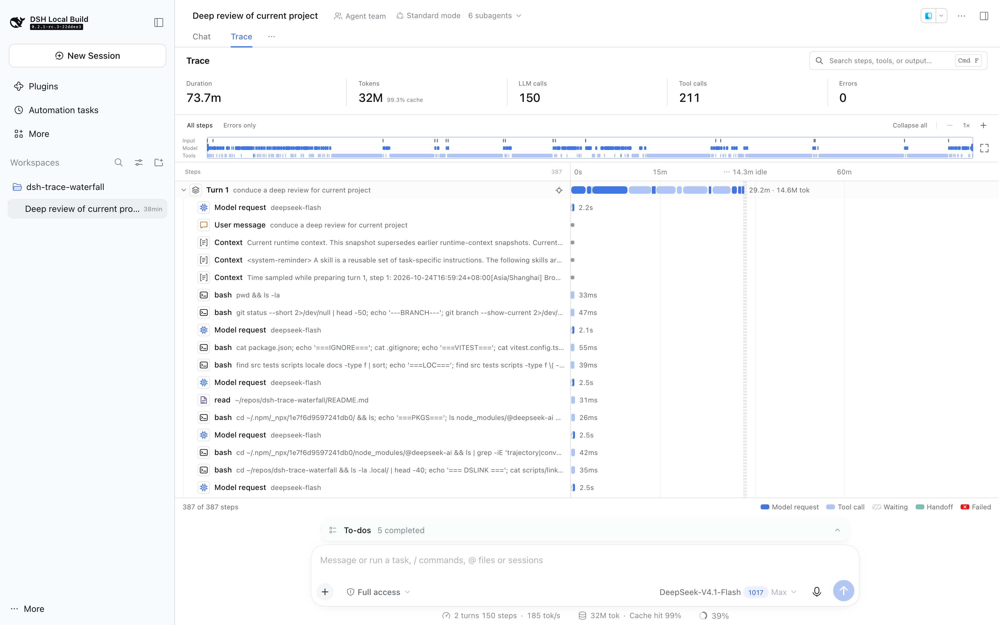
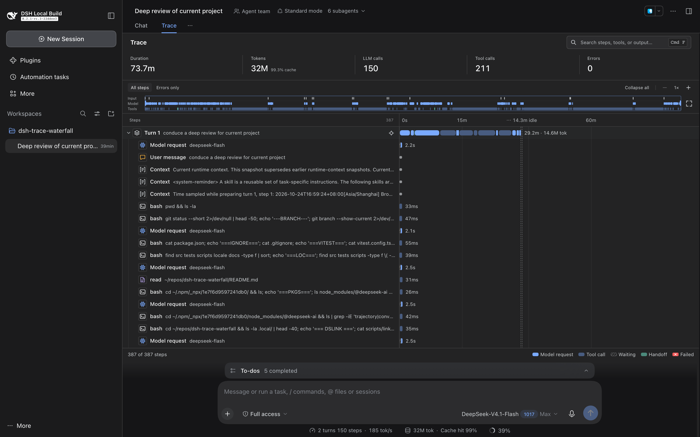
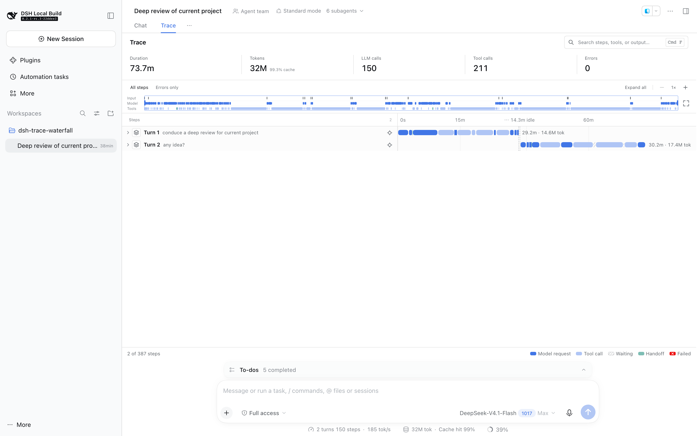
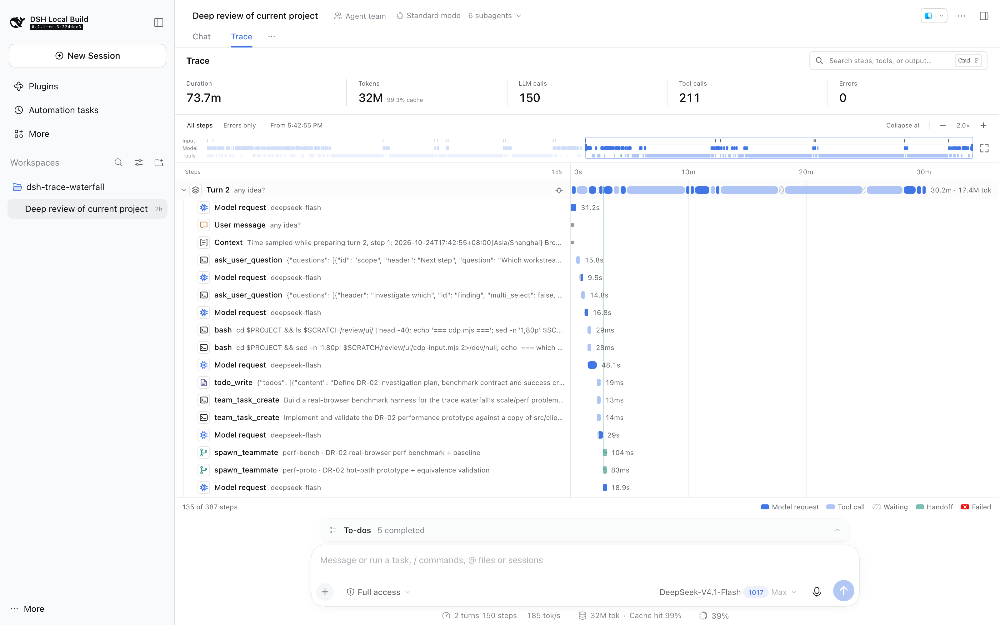
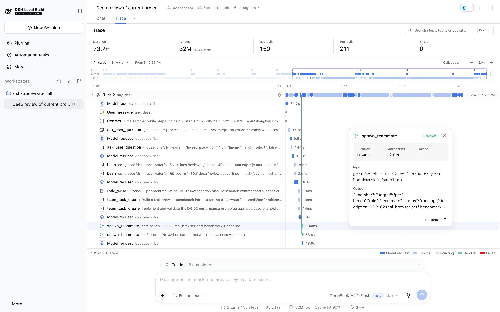

# DSH trace waterfall

A DeepSeek Harness plugin that replaces the trajectory view with a trace waterfall inspired by [Kobra](https://kobra.systems/components/trace-waterfall). The presentation is independently implemented; no Kobra code or assets are included.

- Turn rows show model, tool, waiting, handoff, and failed activity as one segmented bar.
- A three-lane overview (input / model / tools) supports drag-to-zoom; long idle gaps collapse into axis breaks, and any turn can be focused.
- Model bars split time to first token from decoding.
- Click a row or bar for an anchored summary, then open full details for complete input, output, timing, and metadata.

## Video

https://github.com/user-attachments/assets/12101e04-fbdf-4a36-8b71-c1e85642b70f

A 100-second tour: the built-in trajectory view for comparison, the main interactions, and a real agent run recorded live.

## Screenshots











## Install

Requires Node 24.9+ and pnpm 11 on `PATH` (`dsh plugin` uses pnpm; pnpm 10 fails with `ERR_PNPM_ADDING_TO_ROOT`). Targets DSH **0.2.1-rc.3**; DSH's plugin APIs are pre-stable.

Install from GitHub:

```sh
dsh plugin --profile web add github:greatv/dsh-trace-waterfall
```

The bundle's `cordis.patch.yml` disables `ui-trajectory` and adds `trace-waterfall`. The view ID stays `trajectory`, so existing view preferences and tool-inspection links keep working. Restart DSH Web or reload the browser after installing.

To update to the latest commit, run the same `add` command again.

To restore DSH's original trace:

```sh
dsh plugin --profile web remove dsh-trace-waterfall
```

Do not enable both trajectory providers at once; they own the same view.

## Develop

Requires a built DeepSeek Harness checkout:

```sh
npm ci
npm run link:dsh -- <path-to-deepseek-harness>
npm run build
npm test
```

`link:dsh` links the DSH packages and generates TypeScript paths; rerun it after reinstalling dependencies or switching checkouts.

The built `lib/` is committed so that GitHub installs need no build step. Run `npm run build` and commit `lib/` together with source changes.

To install your working copy instead of the GitHub version, run `dsh plugin --profile web add .` from the repository root.

To try the plugin without installing it, run from the DSH checkout:

```sh
pnpm dsh --patch <path-to-this-repository>/cordis.source.patch.yml --no-open
```

For a preview with deterministic test data:

```sh
node scripts/build-preview.mjs
python3 -m http.server 3468 --bind 127.0.0.1 --directory dist/preview
```

## Usage

- **Zoom**: drag across the overview to select a range; double-click to reset. The target icon on a turn focuses it.
- **Live following**: running sessions open at the bottom. New rows stay in view while you remain there; scrolling up, searching, filtering errors, focusing a turn, or opening a summary pauses following. Scroll back to the bottom to resume. Historical sessions open at the top.
- **Stable live axis**: the global view reserves space ahead of the latest call and expands in rounded blocks. Completed bars stay fixed between expansions; when the session ends, the axis fits the recorded end time. Manual zoom and turn focus keep their selected range.
- **Search**: Ctrl/Cmd+F. Matches in names, arguments, prompts, and outputs are highlighted.
- **Errors only**: lists failed operations with their parent context. A recovered failure adds an error badge to its turn instead of marking the whole turn red.
- **Escape** closes the summary or details, or clears filters.

## Notes

- Total tokens = uncached input + cache-read input + cache-write input + output, matching the DSH status bar. Cache hit rate is cache-read input divided by all input.
- Idle gaps longer than 60 seconds are compressed; recorded durations are unchanged.
- Independent child-agent sessions are not merged into the parent trace.
- Cost is not shown, since recorded traces carry no authoritative pricing.
- The plugin is presentation-only: it adds no tools, changes no agent behavior, and sends no telemetry.

## License

The adapter modules derive from DSH's MIT-licensed trajectory implementation. See [THIRD_PARTY_NOTICES.md](THIRD_PARTY_NOTICES.md).
